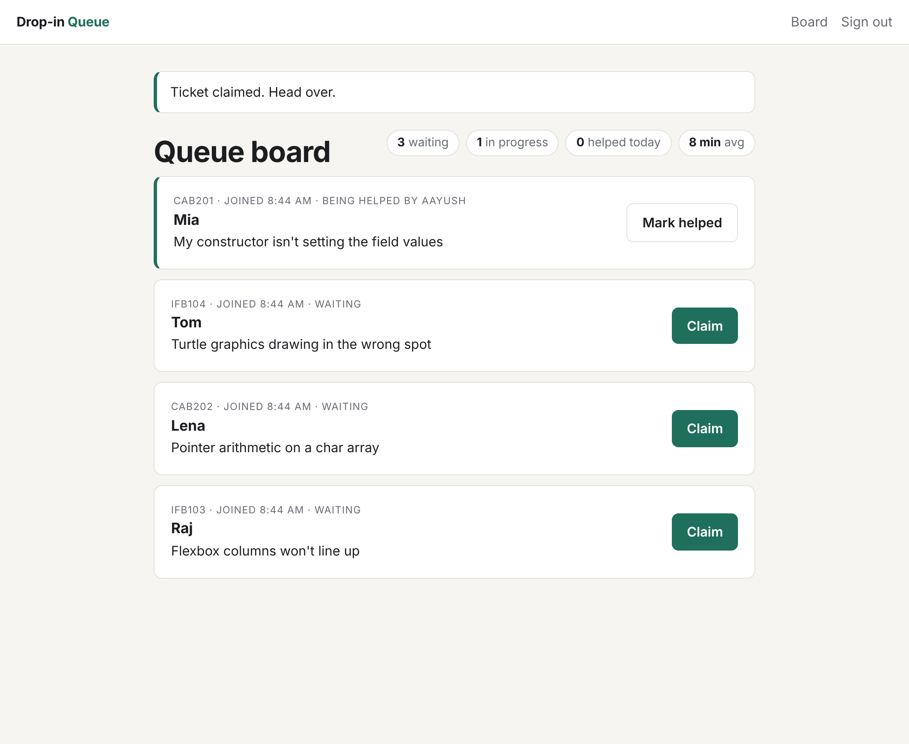
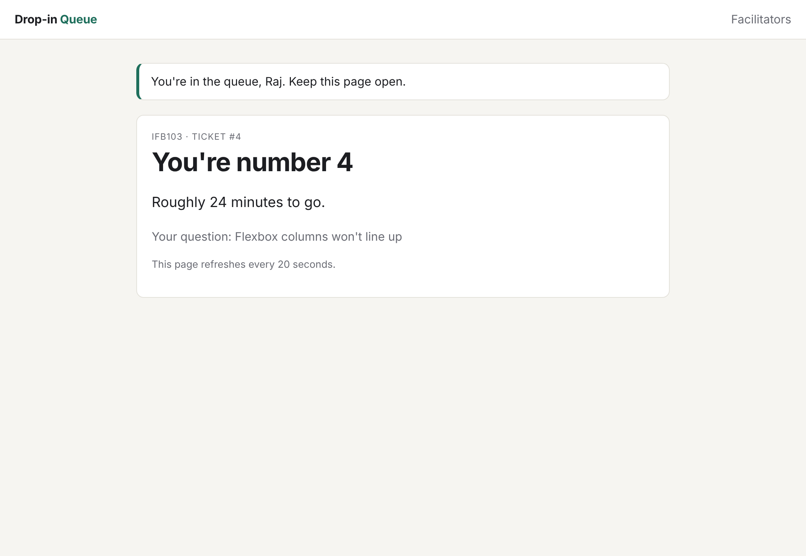
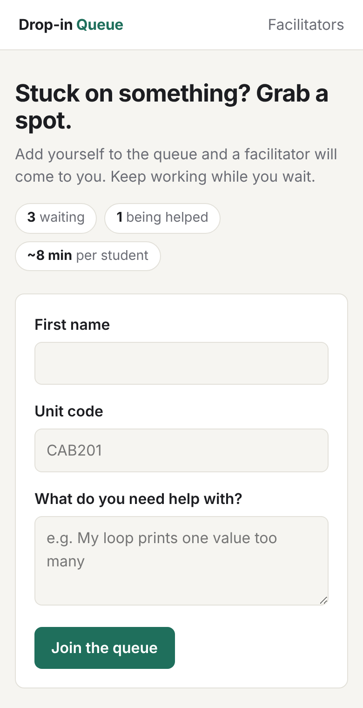

# Drop-in Queue

A help queue for drop-in study sessions, written in plain **PHP 8** on a **LAMP** stack with a small hand-built **MVC** layer.

Students join the queue from their laptop and see their place and a wait estimate. Facilitators sign in to a board, claim the next student, and mark them as helped.



## Why I built it

When I was a Peer Learning Facilitator at STIMulate, QUT's drop-in support service for maths, science and IT, I noticed that on busy nights it was hard to tell who had been waiting longest, and some students left because they couldn't tell how long they'd wait. I built this as a personal project to see how a fair, first-come-first-served queue with an honest wait estimate could work in practice.

I also built it on purpose without a framework. I wanted to understand what Symfony and Laravel do for you (routing, controllers, templates, request handling) by writing a small version of each piece myself.

## Project status

This is a working prototype, not a finished product. I trialled it with a few friends playing students and facilitators, and the feedback was positive, but I haven't tested it with real STIMulate sessions, so I can't yet say whether it would help in a live setting. The next steps are listed under "What I'd do next".

| Student view | Mobile |
| --- | --- |
|  |  |

## What it does

- **Join the queue** with a name, unit code and a short description. Input is validated and normalised (`cab201` becomes `CAB201`).
- **Live position and wait estimate.** The estimate uses the average time facilitators have taken per student today, divided across facilitators on shift, and falls back to 8 minutes when there's no data yet.
- **Facilitator board** behind a shared session PIN: claim, mark helped, and running stats for the session.
- **No double-claiming.** If two facilitators click *Claim* at the same moment, only one wins, because the update only succeeds while the ticket is still `waiting`.
- **Students only see their own ticket**, tracked in their session.

## How it's built

```
public/index.php        Front controller: every request comes through here
src/
  App.php               All routes and dependencies wired in one place
  Core/
    Router.php          Matches method + path (with {params}) to a controller action
    Controller.php      Base class: render, redirect, flash messages, CSRF check
    View.php            Renders a template inside the layout, escapes output
    Database.php        PDO connection from environment variables
    Csrf.php            Per-session tokens for every form
  Controllers/          Thin: read the request, call the service, pick a view
  Models/
    Ticket.php          Immutable entity
    TicketStatus.php    PHP 8.1 enum: waiting -> helping -> resolved
    TicketRepository    The only place SQL lives; prepared statements throughout
  Services/
    QueueService.php    Business rules: validation, positions, wait estimates, stats
views/                  Plain PHP templates
tests/                  PHPUnit tests (service tested against in-memory SQLite)
```

**Model / View / Controller.** Controllers don't contain SQL or business rules. They call `QueueService`, which uses `TicketRepository` for data and returns plain objects for the views to display. That separation is what made the service easy to unit test.

**Security basics I made sure of:**
- Prepared statements for every query (no SQL injection)
- Every value printed in a template goes through `View::e()` (no XSS). I tested this by joining the queue with a `<script>` tag as my name.
- CSRF token on every form, session ID regenerated on sign-in, `HttpOnly` and `SameSite` cookies
- Apache serves only `/public`, so source code and `.env` can't be downloaded

## Run it

**With Docker (full LAMP stack):**

```bash
cp .env.example .env
docker compose up --build
```

Open http://localhost:8080. The facilitator PIN is whatever you set in `.env`.

**Without Docker (quickest, uses SQLite):**

```bash
composer install
sqlite3 /tmp/dropin.sqlite < database/schema.sqlite.sql
DB_DSN=sqlite:/tmp/dropin.sqlite FACILITATOR_PIN=1234 composer serve
```

## Tests

```bash
composer install
composer test
```

15 tests cover the router (params, 404, 405) and the queue rules: ordering, validation, double-claim protection, status transitions, the wait-time maths and session stats. The service tests run the real repository against in-memory SQLite with a fake clock, so time-based results are repeatable.

## How I used AI on this

I used Claude as a coding assistant while building this, which is how I'd expect to work in a team that uses these tools. I wrote the requirements from what I see at STIMulate, chose the structure, and went through every file until I could explain it. The tests and a full click-through of every page are how I checked the AI-assisted code actually does what I wanted, rather than trusting it. That review caught two real bugs: the auto-refresh setting was being set inside a template where the layout could never see it, and the stylesheet wasn't being served under PHP's built-in dev server.

## What I'd do next

- Move to **Symfony** (routing, Twig, Doctrine) and compare it to this hand-rolled version
- Swap the page refresh for server-sent events so the board updates instantly
- Proper facilitator accounts instead of a shared PIN
- A small report of busy times per unit, so sessions can be staffed better
